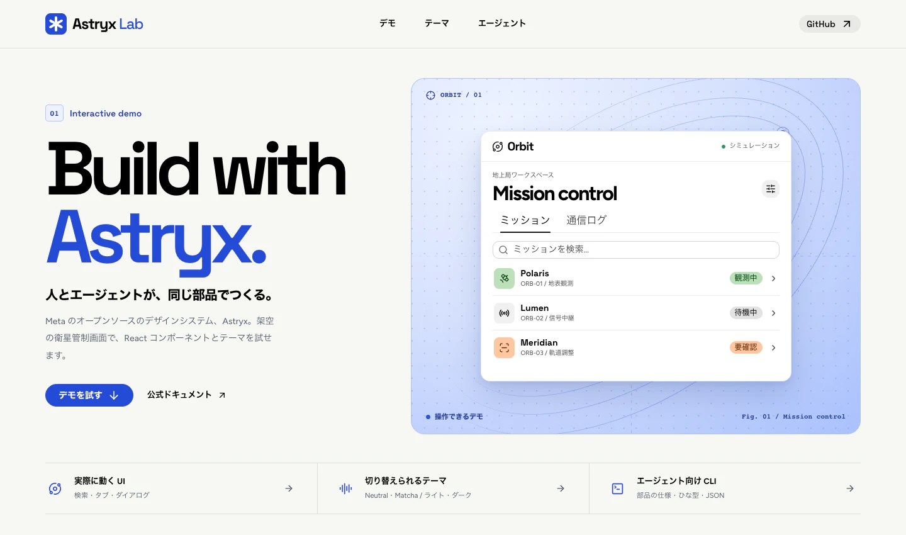
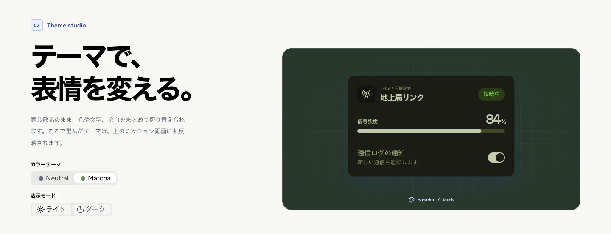

# Astryx Lab

Astryx Lab は、Meta のデザインシステム Astryx を使った非公式の体験サイトです。架空の衛星管制画面を操作しながら、React コンポーネントの使い心地やテーマによる見た目の違いを確かめられます。[Astryx 公式リポジトリ](https://github.com/meta/astryx)



## サイトで試せること

- **衛星管制デモ**では、ミッション名や ID で絞り込み、行を選ぶと軌道高度や地上局を確認できます。「通信ログ」タブには各ミッションの履歴が並びます。
- **テーマスタジオ**では、Neutral と Matcha をライト・ダークで比較できます。選んだテーマは、地上局リンクのカードと衛星管制画面の両方に反映されます。
- **エージェント向け CLI** では、コンポーネントの仕様や画面のひな型を調べるコマンドを、出力例と一緒に見られます。コマンドはページからコピーできます。



*テーマスタジオで Matcha のダーク表示を選んだところ。カード内の通知スイッチも操作できます。*

## 起動する

Node.js 22.13 以上を使います。リポジトリのルートから次のコマンドを実行してください。

```sh
cd meta-astryx
npm ci
npm run dev
```

ターミナルに表示されるローカル URL をブラウザで開きます。

## AI エージェントから Astryx を使う

`meta-astryx` フォルダで公式 CLI を実行すると、インストール済みの Astryx に対応する仕様を参照できます。たとえば、ボタンの使い方を読む、ページのひな型を一覧する、仕様を JSON で取得する、といった操作ができます。[エージェント向けの手順（AGENTS.md）](AGENTS.md)

```sh
npm run astryx -- component Button
npm run astryx -- template --list --type page
npm run astryx -- component Button --json
```

## ビルドを確認する

```sh
npm run build
npm run astryx -- doctor --built dist
npm run preview
```

`dist/` に静的サイトが生成されます。`npm run preview` でビルド済みのサイトを開けます。
